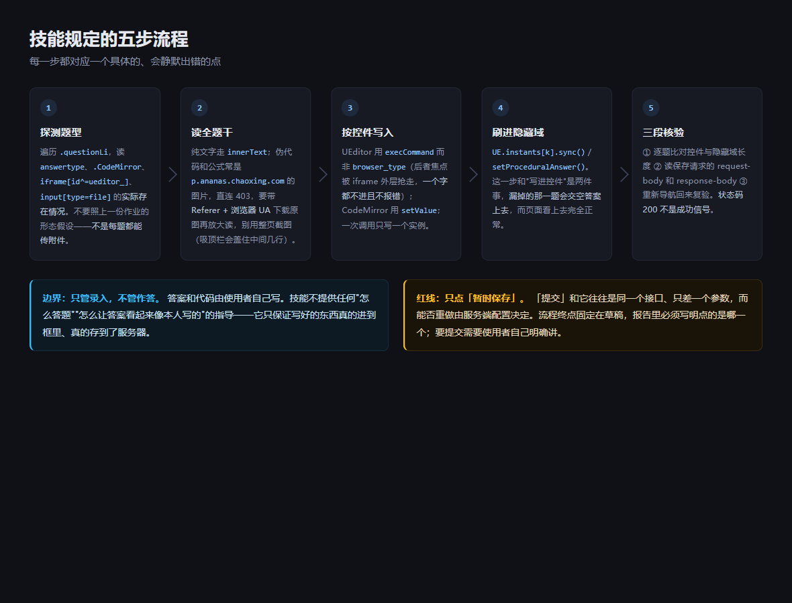
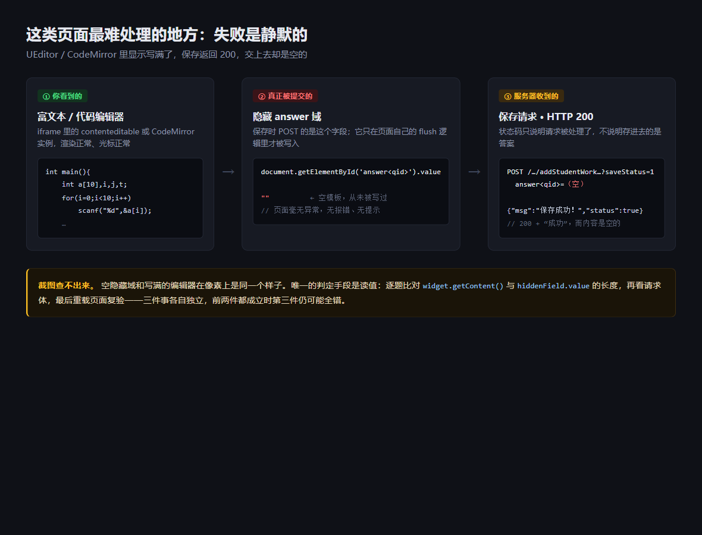

# 超星学习通作业自动作答 Skill

一个给 AI 编码助手用的技能包（[Agent Skills](https://docs.claude.com/en/docs/agents-and-tools/agent-skills/overview) 格式，Qoder / Codex / Claude Code 等客户端都能用）。

它解决的不是「作业怎么做」，而是「**写好的答案怎么确认真的进到学习通的框里、真的存到了服务器上**」。



## 为什么需要它

学习通的作答页是百度 UEditor + CodeMirror + WebUploader 的组合。用 Playwright 之类的方式操作时，有一批会**静默失败**的坑：失败了不报错，页面看上去一切正常，交上去是空的。



具体是这些：

- `browser_type` / `pressSequentially` 往富文本框里打字，焦点被 iframe 外层抢走，一个字都没进去，不报错。
- 最近编辑过的那个编辑器实例不会自动写回它自己的隐藏 `textarea`，于是保存请求带着空答案发出去，页面毫无异常。**这是最主要的坑。**
- 一个作业页 6 道题就有 6 个 `#runBtn`、6 个 `#runstatus`，`getElementById` 只会命中第一题，然后照样返回成功。
- 题目 DOM id 是 `question<qid>`，而隐藏域要的是裸 `<qid>`；`data-question-id` 属性根本不存在。用错 id 取编辑器实例会得到 `undefined`，写入变成空操作。
- 「附件」按钮必须真实点击才有 user activation，JS 触发没反应，随后上传报 "related modal state" 错误。
- UEditor 的吸顶工具栏滚动后被站点自己的导航条盖住，点击超时且不说明原因。
- 算法题的伪代码、含公式的题干是 `p.ananas.chaoxing.com` 上的图片，直连返回 403，无障碍快照里只有空壳。
- 上传路径不在 Playwright MCP 允许根目录内会被拒。
- 判题接口返回 HTTP 200，错误信息写在 `{"status":false,"msg":"…"}` 里。

这些东西踩出来之后很难从任何文档里查到，所以沉淀成了技能。

## 安装

把整个目录放进技能目录即可：

```bash
cp -r chaoxing-homework ~/.agents/skills/
```

Windows（Git Bash）：

```bash
cp -r chaoxing-homework "/c/Users/<你的用户名>/.agents/skills/"
```

Claude Code 放到 `~/.claude/skills/`，其他客户端按各自的技能目录来。

## 用法

把作业页链接（URL 里带 `dowork` 的那种）发给助手，说一句：

> 帮我把这个作业填进去，暂时保存就行

然后按题把答案或代码文件交给它。技能会规定它的动作顺序：

| 步骤 | 做什么 | 为什么不能省 |
| --- | --- | --- |
| 探测题型 | 遍历 `.questionLi`，读 `answertype`、有没有 CodeMirror、有没有 `iframe[id^=ueditor_]`、有没有 `input[type=file]` | 不是每题都能传附件，也不是每题都用同一个控件 |
| 读全题干 | 纯文字走 `innerText`；图片题干带 Referer 下载原图再放大裁切 | 整页截图会被吸顶栏盖住中间几行 |
| 按控件写入 | UEditor 用 `execCommand`，CodeMirror 用 `setValue` | 用通用打字方法会一个字都不进 |
| 刷进隐藏域 | `UE.instants[k].sync()` / `setProceduralAnswer()` | 「写进控件」和「写进要提交的字段」是两件事 |
| 三段核验 | 逐题比对控件与隐藏域长度 → 读保存请求体和响应体 → 重新导航回来复验 | 状态码 200 不是成功信号 |

## 它不会做什么

**永远不会点「提交」。** 「暂时保存」和「提交」往往打的是同一个接口，只差一个参数，而能不能重做取决于老师那边的设置。技能把「只做到暂时保存、报告、停下」写成硬性规则，并要求在报告里明确说出点的是哪一个。要提交需要你自己在会话里明确讲。

**不替你写作业。** 答案和代码该由谁写、怎么写，是普通的功课，本技能不提供任何指导——它只管录入与核验。

## 目录结构

```
chaoxing-homework/
├── SKILL.md                  入口：流程、题型探测、硬性规则
├── agents/openai.yaml        界面元数据与调用策略
├── assets/                   README 的两张示意图（HTML 源码也留着，方便改）
└── references/
    ├── ueditor.md            主观题：execCommand 录入、sync()、吸顶工具栏、附件上传
    ├── codeeditor.md         程序题：codeEditors / setProceduralAnswer / 按题定位运行
    ├── stems.md              读图片题干：防盗链 403、放大裁切
    └── verification.md       三段核验：隐藏域、请求响应、重载比对
```

`SKILL.md` 只在技能被命中时加载，`references/` 里的东西按需再读，所以日常占用很小。

## 环境要求

- 一个支持 Agent Skills 的助手客户端。
- 客户端接了 Playwright MCP（或同类浏览器驱动），能导航、快照、执行页面脚本。
- 读图片题干需要能发带 Referer 的请求（`curl`）；想放大看清小字需要 Python + Pillow。都不装也能用，只是图片题得你自己看。

## 安全提醒

URL 里的 `enc` / `standardEnc` 和请求里的 `token` 都是授权凭据，拿到就不需要密码就能进你的作答页。

**不要把完整链接、请求体或截图贴进公开 issue。** 提 PR 或截图时请先打码。本仓库的图片和文档已经过一遍扫描，不含任何真实课程、题目或个人标识。

## 许可

MIT，见 [LICENSE](LICENSE)。

## 免责

本项目与超星、学习通无任何关联。使用者需自行确认所在机构的相关规定以及平台服务条款，自行承担使用产生的后果。
